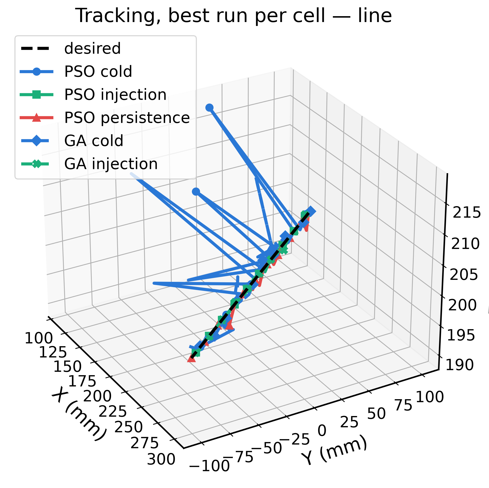
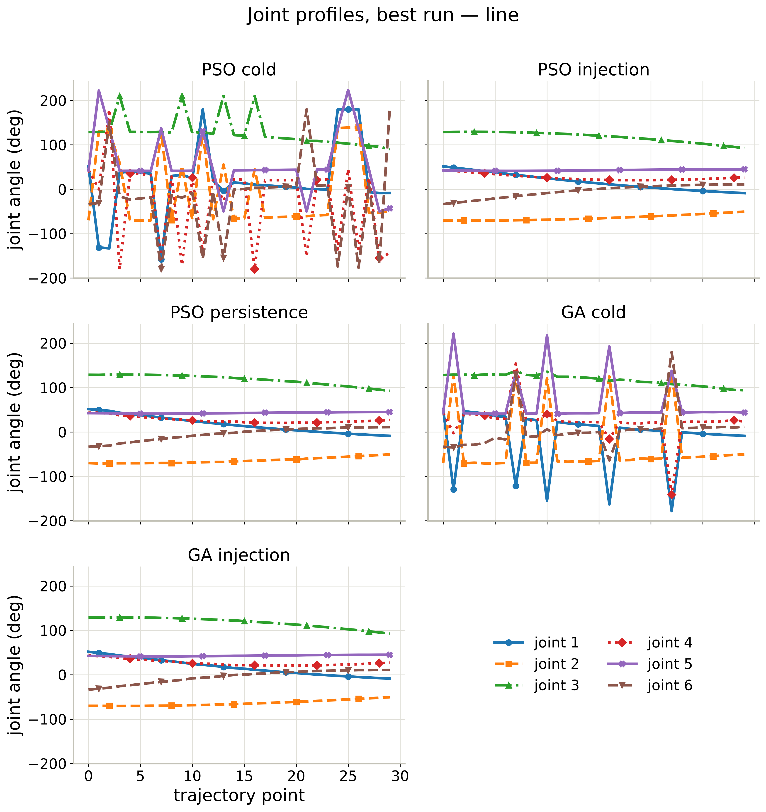

# bimo-ik — cinemática inversa do braço BIMO com metaheurísticas

Estudo comparativo de **PSO** e **algoritmo genético (AG)** para resolver a cinemática inversa de
**pose completa** (posição + orientação) do BIMO, um braço robótico de 6 graus de liberdade,
seguindo trajetórias de 30 pontos. A pergunta central é se a **memória da população** (aproveitar
as soluções do ponto anterior da trajetória) explica a suavidade do movimento, ou se é o algoritmo
em si.



## O que o projeto faz

Um único motor, configurado por arquivo, roda todas as combinações do experimento:

| Fator | Níveis |
|---|---|
| Algoritmo | PSO, AG |
| Memória entre pontos | sem memória (*cold*), injeção (25% da população semeada com a solução anterior), persistência (enxame inteiro, só PSO) |
| Função objetivo | pesos fixos, pesos adaptativos |
| Trajetória | reta, arco, canto vivo (alvos com orientação interpolada por SLERP e alcance verificado) |

- **Função objetivo adimensional:** erro de posição normalizado pelo alcance do braço (calculado da
  tabela DH), erro de orientação normalizado por π e continuidade das juntas normalizada pela
  faixa de cada junta.
- **Estatística planejada:** comparações par a par com teste t de Welch, correção de
  Benjamini-Hochberg (FDR) e tamanho de efeito (d de Cohen).
- **Reprodutibilidade:** cada pasta de resultados tem um `manifest.json` com o hash da configuração,
  as sementes, as versões das bibliotecas e a revisão do git.

## Resultado principal

Com 30 execuções por condição, a memória (por injeção ou persistência) reduz a **rugosidade da
trajetória das juntas** em quase duas ordens de grandeza (d de Cohen ≈ 8, p ajustado ≈ 10⁻²⁴).
A injeção sozinha já dá quase todo o ganho e funciona nos dois algoritmos, então a suavidade vem
da **memória**, não do PSO. A memória não melhora a precisão de posição: o AG sem memória continua
com o menor erro.

Nos perfis das juntas abaixo, as condições sem memória (*cold*) saltam de uma configuração para
outra a cada ponto, enquanto as condições com memória seguem curvas suaves:



## Como rodar

Requer Python 3.11 ou mais novo.

```bash
python -m venv .venv
.venv/Scripts/python -m pip install -e .[dev]      # Linux/macOS: .venv/bin/python

# testes (101)
.venv/Scripts/python -m pytest

# teste rápido de ponta a ponta (N pequeno)
.venv/Scripts/python scripts/run_experiment.py --config lars --smoke

# experimentos completos
.venv/Scripts/python scripts/run_experiment.py --config lars     # conferência: 5 células × 2 trajetórias × 30 execuções
.venv/Scripts/python scripts/run_experiment.py --config full     # periódico: 10 células × 3 trajetórias × 30 execuções (várias horas)

# âncora de reprodução contra o estudo anterior
.venv/Scripts/python scripts/sanity_check.py

# figuras e estatística a partir de uma pasta de resultados
.venv/Scripts/python scripts/make_figures.py --results results/lars
.venv/Scripts/python scripts/run_stats.py --results results/lars
```

## Estrutura

| Pasta | Conteúdo |
|---|---|
| `src/bimo_ik/kinematics/` | modelo DH, cinemática direta, utilidades de SO(3), escalas características |
| `src/bimo_ik/trajectories/` | geradores de trajetória e verificação de alcance |
| `src/bimo_ik/fitness/` | função objetivo adimensional (pesos fixos e adaptativos) |
| `src/bimo_ik/algorithms/` | PSO (cold/injeção/persistência) e AG (cold/injeção) |
| `src/bimo_ik/experiment/` | matriz de células, execução paralela, manifesto |
| `src/bimo_ik/metrics/` e `stats/` | precisão, executabilidade cinemática, esforço vs. ε; comparações, FDR, efeito |
| `scripts/` | execução, estatística, figuras, linha de base Levenberg-Marquardt |
| `results/` | resultados dos experimentos (`lars`, `full`, `sanity`, `ablation_wj0`, `lm_baseline`), com as figuras geradas em `figures/` de cada pasta |
| `reference/` | cópia congelada do código do estudo anterior (só proveniência, nunca importada) |
| `legacy/` | versões anteriores do estudo, de abril a junho de 2026 |

## Histórico

O projeto nasceu de um artigo submetido ao CBA 2026 que foi rejeitado. Os revisores apontaram que a
comparação era enviesada (só o método proposto mantinha a população entre pontos) e que as
conclusões iam além das evidências. Esta versão foi reconstruída do zero para isolar a memória
como fator experimental. As versões anteriores estão em `legacy/`.

## O que aprendi

- **Comparar de forma justa é mais difícil que implementar.** A parte mais difícil foi encontrar
  uma metodologia que comparasse os algoritmos sem favorecer nenhum: separar a memória do
  algoritmo, normalizar a função objetivo e planejar as comparações antes de rodar.
- **Metaheurísticas na prática:** como PSO e AG exploram o espaço de juntas e como a
  inicialização muda o resultado tanto quanto o próprio algoritmo.
- **Análise estatística:** teste de Welch, correção de múltiplas comparações (FDR) e tamanho de
  efeito, em vez de olhar só a média.
- **Escrita científica:** transformar resultados em artigo e responder a críticas de revisores.
- **O que faria diferente:** uma revisão bibliográfica mais completa desde o início e validar
  em outros simuladores de braço (MATLAB Robotics Toolbox, ROS) antes de fechar o modelo.
